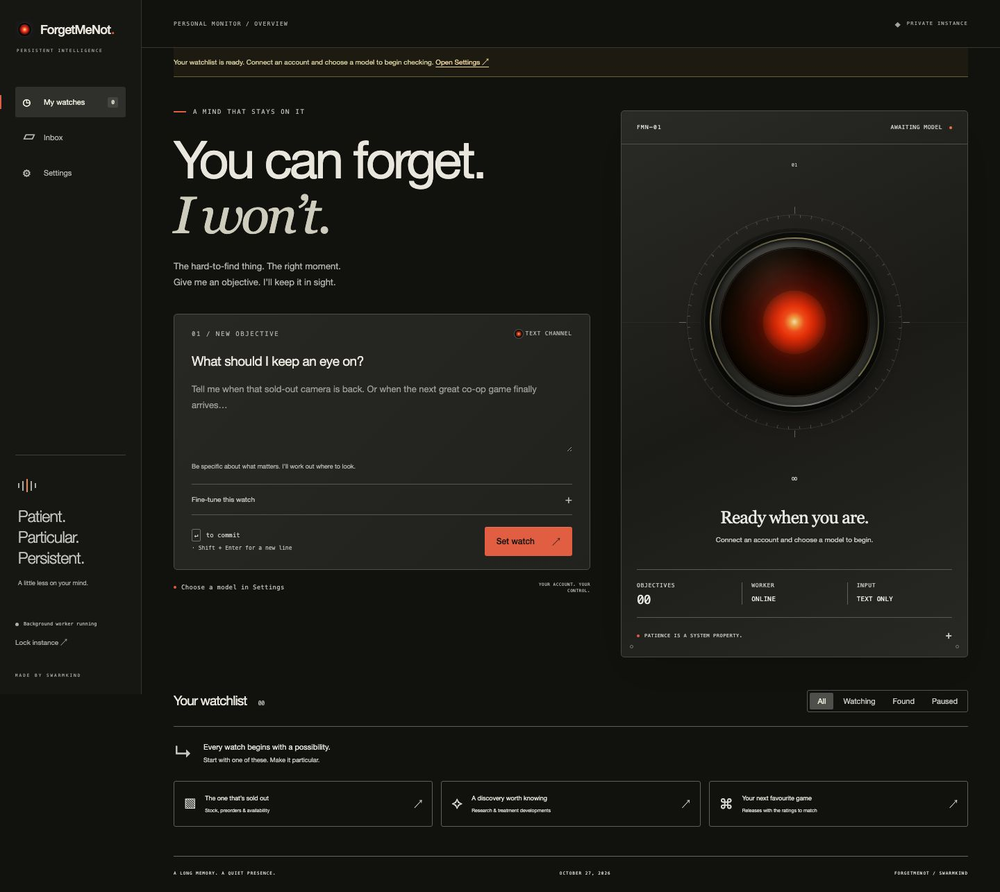

# ForgetMeNot

You can forget. I won’t. A small, self-hosted application that keeps checking for things you care about and tells you when the right moment arrives.

Write a goal in plain English: an item returning to stock, a preorder opening, a promotion, a particular bond yield crossing a threshold, an approved treatment, or a well-reviewed co-op game. Choose your AI account and model. ForgetMeNot searches for current evidence on a persistent schedule, keeps a history, and delivers matches to your inbox, email, or phone.

**Version 0.1 is a single-owner developer preview.** The scheduler, interface and provider adapters are implemented and covered by offline tests. Live account authorization, paid searches and external email/push delivery need verification with your accounts before relying on unattended monitoring. It is a research monitor, not a guaranteed real-time stock or market-data feed.



[Listening](docs/listening.jpg) · [Focus acquired](docs/focused.jpg) · [Phone layout](docs/mobile.jpg)

## What it does

- Plain-language watch creation, editing, pause/resume, immediate checks and history.
- A responsive optical mascot: receptive while you type, focused when you submit, and tied to real check/worker states. Enter sets a watch; Shift+Enter adds a line. Animation respects reduced-motion preferences. No microphone or camera access.
- Automatic check frequency or fixed intervals: minute, 5/15 minutes, hourly, 6 hours, daily, weekly, or 30 days.
- Provider-selected search strategy with evidence links and an explanation of what it checks.
- Separate **waiting**, **matched**, and **inconclusive** outcomes. Unavailable sources and failed searches never count as confirmed matches.
- One notification per successful watch. A match completes the watch; rearm it when you want another.
- Persistent SQLite scheduling, restart recovery and a durable notification outbox.
- In-app inbox, email through your SMTP server, and phone push through [ntfy](https://ntfy.sh).
- An attention notice after three consecutive inconclusive checks, delivered through the watch’s configured channels.
- Password-protected instance, encrypted account credentials, PKCE/state/nonce validation, verified OpenAI ID tokens, and no client-side credential storage.
- Buildless HTML/CSS/JavaScript frontend. One Python process. No Redis, task queue service or frontend build step.

## Start with Docker

```sh
git clone https://github.com/swarmkind/ForgetMeNot.git
cd ForgetMeNot
cp .env.example .env
chmod 600 .env
```

Set a unique `FORGETMENOT_PASSWORD` of at least 12 characters in `.env`, then:

```sh
docker compose up -d --build
```

Open **http://127.0.0.1:8787**, unlock the instance, and open **Settings**. Connect your account, load available models, choose one, and save your first watch. You can save watches before connecting a model; they wait until the model is configured.

The Docker service restarts automatically and keeps data in the `forgetmenot-data` volume. Run one replica; the process lock intentionally refuses concurrent workers on the same data directory. Don’t run this app under a multi-worker ASGI configuration.

The base image supports OpenRouter, ChatGPT and Claude API connections. **The optional Google subscription adapter requires Gemini CLI on the same host/user as the Python process; it is not included in the base Docker image.** Use the native installation below for Google, or extend the image with an official Gemini CLI installation and a protected persistent home directory. Never bake OAuth credentials into an image.

## Native installation

Python 3.12+ on Linux or macOS, with [uv](https://docs.astral.sh/uv/):

```sh
uv sync --frozen
cp .env.example .env
chmod 600 .env
# Edit .env first; keep it private.
uv run --env-file .env forgetmenot
```

Without uv, `python -m venv .venv` followed by `.venv/bin/pip install .` installs the app. Export the variables from `.env` using your service manager, then run `.venv/bin/forgetmenot`. Use a systemd unit or another supervisor for an always-on native deployment.

Native data defaults to `.data` under the current working directory. Set `FORGETMENOT_DATA` to an absolute persistent directory in a service. `FORGETMENOT_HOST` defaults to `127.0.0.1`; the port defaults to `8787` and can be set with `FORGETMENOT_PORT`. Update `FORGETMENOT_BASE_URL` to the exact browser origin if you change the port.

## Account connections

| Connection | How it works | Billing/limits |
| --- | --- | --- |
| OpenRouter | Paste an OpenRouter API key, or authorize with OAuth PKCE in Settings. Load the live model catalog. | Your OpenRouter credits; web search costs extra, including with free models. |
| ChatGPT | **Continue with ChatGPT** using OpenAI’s official open-source Sign in with ChatGPT flow. Tokens are verified, encrypted and refreshed on the server. | Eligible ChatGPT plan usage/credits, subject to the permissions and limits you grant. |
| Google subscription | Official Gemini CLI, previously signed in with the Google account associated with your subscription. ForgetMeNot runs the CLI in headless mode with search-only tools. | The account’s Gemini CLI allowance. Eligibility and limits depend on Google. |
| Claude | Claude Console API key, or a Claude model through OpenRouter. | API billing / OpenRouter credits. Claude Pro/Max OAuth tokens are deliberately not accepted. |

These connections are not interchangeable OAuth keys. OpenAI publishes an open-source subscription flow. Google’s documented subscription route here is the official CLI. Anthropic directs developers building third-party applications to API authentication; this app does not impersonate Claude Code to consume a subscription allowance.

Official references: [OpenRouter OAuth](https://openrouter.ai/docs/guides/overview/auth/oauth), [OpenRouter search](https://openrouter.ai/docs/guides/features/server-tools/web-search), [OpenAI open-source sign-in](https://developers.openai.com/siwc/token-sharing-open-source), [OpenAI models and inference](https://developers.openai.com/siwc/token-sharing-open-source/models-and-inference), [Gemini CLI authentication](https://geminicli.com/docs/get-started/authentication/), [Anthropic third-party authentication guidance](https://support.claude.com/en/articles/13189465-log-in-to-your-claude-account).

### ChatGPT: local or remote server

OpenAI’s open-source registration requires an **HTTP loopback callback on `127.0.0.1`**, not `localhost` or an arbitrary hosted domain. The default configuration uses `http://127.0.0.1:8787/auth/callback`.

For a remote host, keep the app’s loopback base URL and use an SSH tunnel from your browser’s computer:

```sh
ssh -N -L 8787:127.0.0.1:8787 user@your-server
```

Open `http://127.0.0.1:8787` locally and perform sign-in there. The callback follows the tunnel to the server. The server retains its own stable host ID and owns later refreshes. Keep that same loopback origin for access; an HTTPS hosted origin supports OpenRouter and Claude but disables this ChatGPT sign-in route. See [OpenAI’s VM guidance](https://developers.openai.com/siwc/token-sharing-open-source/self-hosted-vms) for the provider’s remote-host considerations.

Saved ChatGPT registrations appear in Settings. Use a saved connection, reconnect it, or add a separate account. Switching accounts clears the model selection so the catalog can be loaded for the selected account. **Disconnect** attempts remote session revocation before removing local tokens; if revocation fails, the app reports that fact and retains the session for a retry. You can also revoke access in [ChatGPT Settings → Usage](https://chatgpt.com/settings/usage).

### Google: official Gemini CLI

Install a current Gemini CLI using [Google’s installation instructions](https://geminicli.com/docs/get-started/installation/). Under the OS user that will run ForgetMeNot, run `gemini` once and select **Sign in with Google**. Use the account associated with your Google AI subscription. Then select **Google subscription · Gemini CLI** in ForgetMeNot, load models, and select `auto` or enter a model ID your CLI supports.

ForgetMeNot never reads or copies Google OAuth tokens. Each check uses an empty temporary working directory and system-level CLI settings restricting built-in tools to `google_web_search`. It disables hooks, MCP servers, extensions and skills, and passes a small environment allowlist without the app’s password, SMTP secrets or other providers’ credentials. The CLI owns its login and renewal. Use a dedicated OS user and a current CLI release that supports these restrictions. The adapter is tested with recorded-format fixtures and a mocked CLI launch; it has not been exercised against a real Google account in this checkout.

## Notifications

### In-app

The inbox is always enabled. Matches include the supporting sources and remain readable if email or push delivery fails. New findings stop the watch, so closing and reopening a browser does not generate another alert. **Rearm** deliberately enables a new match and another notification.

### Email

Set the following in `.env` before starting/restarting the server:

```dotenv
SMTP_HOST=smtp.your-provider.example
SMTP_PORT=587
SMTP_SECURITY=starttls
SMTP_FROM=forgetmenot@your-domain.example
SMTP_USER=your-smtp-user
SMTP_PASSWORD=your-smtp-password
```

Use `SMTP_SECURITY=tls` and port `465` for implicit TLS. There is no plaintext SMTP option. Save your destination email address in Settings and enable **Email** in each watch’s advanced controls. SMTP credentials stay in the server environment and never pass through the browser.

### Phone push

Install the [ntfy mobile app](https://docs.ntfy.sh/subscribe/phone/), subscribe to an unguessable topic on **ntfy.sh**, then enter that topic and an optional ntfy access token in Settings. Enable **Push via ntfy** on each relevant watch.

**Use an access-controlled topic for sensitive findings.** An unguessable public topic is not access control; anyone who learns its name can read it. Push sends the finding and source links to ntfy.sh. Direct browser Web Push, native mobile apps and custom ntfy servers are not implemented in 0.1.

## Schedules, evidence and reliability

The background thread claims one due watch at a time, checks it, and commits the result and notification queue together. A ten-minute lease protects in-flight work. A crashed process’s abandoned check becomes eligible after that lease expires. A restart performs one fresh check for an overdue watch rather than replaying every missed interval. Three consecutive inconclusive checks create one attention notice through the same channels, so an expired account or broken source does not disappear silently. A successful check resets that failure streak.

Pausing, editing or deleting a watch invalidates an in-flight result so it cannot create a notification later. Delivery attempts already in progress may finish. Notifications use **at-least-once delivery**: a crash after the external service accepts a message but before the app records success can produce a duplicate. Failed deliveries use capped exponential retries and remain visible in the inbox.

Automatic frequency is chosen by the model on each completed check from the supported interval list. Fixed frequency overrides its suggestion. Inconclusive checks retain a visible error and use backoff without exceeding the configured check rate. Your server must stay awake and connected; it cannot search while powered off. Slow provider requests and other due watches can delay minute-level checks. The sidebar reports the worker state, and each watch shows its last and next checks.

Evidence URLs must match actual provider search citations. A response without citations, with unsupported evidence URLs, with invalid JSON, or without confirmed provider completion cannot produce a match. This establishes source provenance; it **does not prove that the model interpreted the page correctly or that a search index has live data**. Keep financial/medical/product criteria explicit and review the primary sources. For tick-level quotes or guaranteed stock detection, use a dedicated feed; this preview uses AI web research for every check.

Minute-level monitoring can run **1,440 checks per day per watch**. Model and search charges are separate, provider allowances can run out, and provider/model compatibility can change. Set spend limits in the provider account. OpenRouter checks use at most two Exa search calls and ten total results; Claude API checks use at most two searches. Account and model catalogs are fetched on demand, not hardcoded as available entitlements.

## Data and backups

The data directory contains SQLite, its WAL files, a process lock, and `master.key`. Provider credentials, connection metadata and settings are encrypted with Fernet. The key is stored separately in the same protected runtime directory; protect the volume and use full-disk encryption if you need protection from host access. Goals, check history and inbox content are ordinary SQLite data, not individually encrypted.

Stop the service and back up the **entire data directory/volume**, including `master.key`. Restart after copying it. The app refuses to generate a new key over an existing database with a missing key. Protect backups as credentials. Do not run `docker compose down -v` unless you mean to permanently delete your watches and keys.

The app’s session cookie is HttpOnly and SameSite=Lax, with Secure enabled on HTTPS. Sessions expire after 24 hours and are invalidated by a server restart or logout. CSRF headers/origin and Host checks protect mutating requests. Application access logs are disabled to avoid retaining OAuth callback codes. Configure any reverse proxy to redact callback query strings as well. Credentials never enter browser localStorage, JavaScript bundles or API state responses.

Keep the default loopback binding or use the SSH tunnel. For a private network deployment behind a reverse proxy, bind the container port to your intended interface, set `FORGETMENOT_BASE_URL` to its exact HTTPS origin, retain the original Host header, and terminate TLS at the proxy. This preview is for one trusted owner; it is not a multi-tenant public service.

## Development and verification

```sh
uv sync --frozen
uv run python -m unittest discover -s tests -v
node --check forgetmenot/static/app.js
node tests/mascot.test.cjs
```

The test suite uses temporary data and mocked provider calls: no real account tokens, paid inference, email or push sends. An optional [GitHub Actions template](docs/github-actions-tests.yml) runs these checks on Python 3.12 and 3.13. To enable it, copy it to `.github/workflows/tests.yml` using a GitHub connection with workflow permission; the connection used for this publication lacks that permission, so automated CI is not enabled. See [verification notes](docs/VERIFICATION.md) for what was actually checked in this checkout.

The code is deliberately small: `store.py` owns SQLite and encrypted settings, `providers.py` owns research adapters and result validation, `auth.py` owns login and OAuth, `worker.py` owns scheduling/delivery, and `app.py` exposes the local API. The frontend is in `forgetmenot/static/`.
