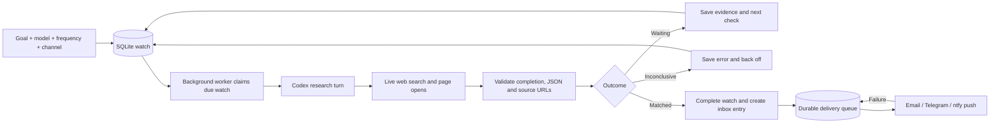

# Research harness

ForgetMeNot reuses the [official open-source Codex runtime](https://github.com/openai/codex) for ChatGPT research. It adds a small persistent scheduler and notification outbox. Other connections continue to use their provider search adapters; they do not all run through Codex.



The model chooses how to research the goal and judges its conditions against current sources. Each turn receives the goal, creation time, prior check time, prior result and previous strategy. It can refine that strategy on later turns. This is scheduled autonomous research, rather than a fixed keyword scraper. It does not have Grok Bot’s full computer/app access.

For Codex, each turn starts in an empty temporary directory with a private runtime home. User config and project instructions are ignored. Shell tools, apps, plugins, MCP servers, hooks, memories, local skills and subagents are disabled. Only web research is requested. The adapter rejects failed/incomplete turns and unexpected command/file/MCP events. Sources in a confirmed result must appear among the turn’s directly opened public web URLs. Unsupported or missing sources turn the finding into **inconclusive**. This checks provenance; it cannot prove the model interpreted the source correctly.

The worker runs independently of the browser. One due watch is claimed at a time, with a ten-minute lease for crash recovery. A successful match atomically saves history, completes the watch and creates its inbox/notification queue entries. Matching stops that watch until it is rearmed. External deliveries retry independently, including when model access fails. A crash immediately after an external send can still cause a duplicate; delivery is at least once. Telegram chunks may repeat if a later chunk fails.

Watch histories show the conclusion, model, source links and actual Codex web actions. A rejected or inconclusive turn cannot silently become a confirmed match. Three consecutive inconclusive checks create one attention notice. Fixed frequency overrides the model’s suggested cadence; automatic frequency uses its suggestion. The server must remain running, awake and connected.

## Executed live check

On 2026-10-27, using the owner-authorized private copy of the existing ChatGPT sign-in, Codex CLI 0.164.0 and `gpt-6.1-sol`:

| Goal | Actual result | App behavior |
| --- | --- | --- |
| Official Python downloads page offers a stable Python 3 release | Matched, about 15 seconds | History and one inbox notification committed; watch completed |
| Official Python downloads page offers a stable Python 9 release | Waiting, about 14 seconds | History saved and next check scheduled; no match notification |
| Discover whether Split Fiction is released for PC, supports online co-op and clears an overall Steam rating/review-count threshold | Inconclusive, about 29 seconds | Found the Steam listing through search and opened three page variants; withheld an alert because the all-language rating could not be verified |

The first two turns directly opened `https://www.python.org/downloads/`. An additional worker cycle produced no duplicate notification. The waiting and inconclusive tests were paused after their checks to avoid ongoing usage. The discovery test verified release and co-op support, but the accessible rating was English-only; it did not substitute that for the requested overall rating. The exact sanitized goals, model results, source links and web actions are in [live-harness.json](live-harness.json). These are model research findings, not independent verification of every factual sentence in the summaries.

The browser also saved a real watch with a pinned model through Enter, inspected the live history, and verified lens contraction. That test watch was paused. UI searching/error/offline/found branches were additionally checked with local API response fixtures, without extra paid inference.

No live email, Telegram or push was sent: no external destination credentials were supplied. Deterministic tests exercise the real worker, Codex adapter/event parser, SQLite restart and outbox. Only the CLI process and HTTP transports are controlled at the I/O boundary: waiting → matched → restart → Telegram failure and retry, while push succeeds independently. Separate tests verify TLS SMTP construction, complete source links, Telegram chunking, credential isolation, model pinning and migration from the previous database schema.

## Repeat the offline checks

```sh
uv run python -m unittest discover -s tests -v
node --check forgetmenot/static/app.js
node tests/mascot.test.cjs
```

For another live check, connect Codex in Settings, select an account model, create a goal with a clear condition and an official source, then inspect **Watches → History** and **Inbox**. Use a condition known to be false as well as one known to be true. Pause the false case afterward. External destinations need their own real delivery check before relying on them unattended.
